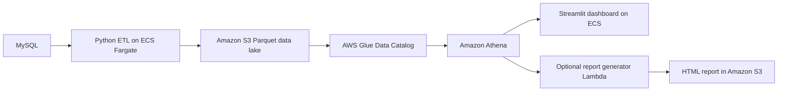

# Catering Fleet Data Migration and Analytics Platform

An end-to-end data engineering project that moves food-truck transaction data from MySQL into an AWS data lake, then makes it available through an interactive dashboard and a daily HTML report.

## Project Overview

This project modernises sales-data processing for a mobile catering business whose food trucks record transactions in a MySQL database. It provides a data pipeline that extracts transaction and reference data, validates and transforms it, and stores it as Parquet in Amazon S3. Transaction records are partitioned by date, and an S3 offset tracks which transaction IDs have already been processed.

AWS Glue and Amazon Athena make the data available for analysis. A Streamlit dashboard presents revenue and sales summaries and trends, while a report generator can produce a previous-day HTML performance report locally or as an optional AWS Lambda function that stores the report in S3.

The pipeline is scheduled with Amazon EventBridge Scheduler to run on weekdays. The report Lambda is not scheduled and does not send email in the current Terraform configuration.

## Project Objectives

The project aims to:

- Move operational sales data from MySQL into an analytical data lake on Amazon S3.
- Incrementally ingest new transactions using a transaction ID offset.
- Validate and transform transaction and reference data into Parquet datasets partitioned by date.
- Catalogue and query the datasets with AWS Glue and Amazon Athena.
- Provide an interactive dashboard for exploring truck revenue and sales trends.
- Generate a detailed HTML report of previous-day fleet performance, with optional Lambda deployment.
- Provision supporting AWS infrastructure with Terraform and package services with Docker.
- Test core pipeline, dashboard, and report logic with pytest.

## Architecture



The ETL task is scheduled by Amazon EventBridge Scheduler at 09:15, 12:15, 15:15, and 18:15, Monday to Friday, in the `Europe/London` time zone. The dashboard is an ECS service that can be scaled up or down. The report Lambda can be deployed after its container image is pushed to ECR; scheduling or emailing it requires additional configuration.

## Repository layout

```text
.
├── dashboard/       # Streamlit application, Athena wranglers, Docker configuration
├── pipeline/        # ETL extraction, transformation, loading, and offset handling
├── report/          # HTML report generator and Athena data wranglers
├── scripts/         # Build, deploy, run, and dashboard scaling scripts
├── terraform/       # AWS infrastructure definitions
├── tests/           # Unit tests for pipeline, dashboard, and report logic
├── visualisations/  # Exploratory analysis notebook
├── .github/skills/  # Project-specific AI development skills
├── env_template     # Template used by Terraform to generate the local deployment .env
└── requirements.txt # Combined local development dependencies
```

## Technology

Python, MySQL, pandas, Streamlit, Docker, Terraform, Amazon S3, AWS Glue, Amazon Athena, Amazon ECS/Fargate, Amazon EventBridge Scheduler, Amazon ECR, AWS Lambda, AWS Secrets Manager, and pytest.

## Prerequisites

For local development, install Python 3.10 or later and the dependencies for the component you plan to run. Docker and Docker Compose are needed for container workflows. Deploying to AWS also requires the AWS CLI, Terraform, AWS credentials, and access to the relevant AWS services.

The Terraform configuration expects an existing ECS cluster, VPC, and public/private subnet IDs. The source database must contain the transaction and reference tables used by the pipeline. The dashboard and report query the `FACT_Transaction` and `DIM_Truck` Athena tables; the pipeline also loads `DIM_Payment_Method`.

## Configuration

Create a local `.env` file in the repository root for local runs. Do not commit it. Pipeline configuration requires:

```dotenv
DB_HOST=your-database-host
DB_PORT=3306
DB_NAME=your-database-name
DB_USER=your-database-user
DB_PASSWORD=your-database-password
S3_BUCKET_NAME=your-data-lake-bucket
AWS_REGION=your-aws-region
```

The dashboard and report generator also need `GLUE_DB_NAME` and `S3_BUCKET_NAME`. AWS SDK credentials may be provided by a configured AWS profile rather than access keys in `.env`.

For Terraform, create `terraform/terraform.tfvars` with values for the variables in `terraform/variables.tf`: `INFRASTRUCTURE_NAME`, `AWS_REGION`, `DB_HOST`, `DB_PORT`, `DB_NAME`, `DB_USER`, `DB_PASSWORD`, `ecs_cluster_arn`, `vpc_id`, `public_subnet_id`, `private_subnet_id`, and `deploy_report_generator_lambda` (`"no"` for the initial deployment). This file and Terraform state contain sensitive infrastructure information and must not be committed.

Terraform uses [`env_template`](env_template) to write a repository-root `.env` file with non-sensitive deployment values for the scripts. Deployed ECS tasks receive database credentials from AWS Secrets Manager. The generated `.env` does not contain the database credentials needed for local pipeline runs, so add those locally when running the pipeline outside AWS.

## Run locally

Use a virtual environment and install the dependencies for the component you want to run. Run commands from the repository root unless noted otherwise:

```bash
python -m venv .venv
source .venv/bin/activate
```

Install the ETL dependencies and run the pipeline:

```bash
pip install -r pipeline/requirements.txt
python pipeline/pipeline.py
```

The pipeline reads the current transaction ID offset from `s3://<bucket>/offset.json`, loads dimension tables in full, and loads transactions newer than the offset. It writes Parquet data under `s3://<bucket>/Food_Trucks/`, partitioning transactions by `year`, `month`, and `day`. The offset is updated only after a successful load. The individual `extract.py`, `transform.py`, and `load.py` modules can also be run from `pipeline/` for local CSV-based debugging.

Install the dashboard dependencies and run Streamlit:

```bash
pip install -r dashboard/requirements.txt
streamlit run dashboard/dashboard.py
```

Open the local URL printed by Streamlit, normally `http://localhost:8501`. The dashboard provides Revenue Summary, Revenue Trends, Popularity Summary, and Popularity Trends views. It caches Athena query results for 30 minutes.

Alternatively, run the dashboard in Docker:

```bash
docker compose -f dashboard/docker-compose.yml up --build
```

Open `http://localhost:8501`; stop the container with `docker compose -f dashboard/docker-compose.yml down`.

The pipeline can also run in Docker:

```bash
docker compose -f pipeline/docker-compose.yml up --build
```

Install the report dependencies and generate the previous day's HTML report locally:

```bash
pip install -r report/requirements.txt
python report/local_report_generator.py
```

This writes `daily_report_YYYY_MM_DD.html` to the current directory. The report queries Athena, so configure `GLUE_DB_NAME`, `S3_BUCKET_NAME`, and AWS credentials/profile first.

## Deploy to AWS

The Terraform configuration provisions project resources but expects an existing ECS cluster, VPC, and subnet IDs. Set up AWS credentials, create `terraform/terraform.tfvars`, and review each plan before applying:

```bash
cd terraform
terraform init
terraform plan
terraform apply
```

The first apply creates the shared resources and generates the root `.env` file used by deployment scripts. Run the following deployment commands from the repository root:

```bash
bash scripts/deploy_pipeline.sh
bash scripts/run_pipeline.sh
```

The first command builds and pushes the pipeline image. The EventBridge Scheduler then runs the ECS task at 09:15, 12:15, 15:15, and 18:15, Monday to Friday, in the `Europe/London` time zone. The second command starts a one-off run and waits for its result.

Deploy and start the dashboard (this builds and pushes its image, then scales its ECS service to one task):

```bash
bash scripts/start_dashboard.sh
```

The dashboard security group permits port 8501 only from the public IP detected during Terraform apply. Scale the service to zero when it is not needed:

```bash
bash scripts/stop_dashboard.sh
```

The report Lambda is optional and is not scheduled or configured to email reports. To deploy it, first push its container image:

```bash
bash scripts/deploy_report_generator.sh
```

Then set `deploy_report_generator_lambda = "yes"` in `terraform/terraform.tfvars` and apply Terraform again. The Lambda writes generated HTML reports to `s3://<bucket>/reports/`. Add a schedule or email delivery separately if required.

## Tests

The repository contains unit tests for ETL extraction and transformation, dashboard and report data wranglers, logging, and path handling. Install the combined development dependencies and pytest, then run from the repository root:

```bash
pip install -r requirements.txt pytest
pytest tests/
```

## AI-assisted development

I used AI tools during development to help improve code structure, create focused tests, and maintain project documentation. I reviewed AI-generated suggestions and validated changes with tests where relevant.

I also created two project-specific skills under [`.github/skills/`](.github/skills/) to capture reusable guidance for AI-assisted development. They are not runtime dependencies:

- [clean-code-small-functions](.github/skills/clean-code-small-functions/SKILL.md) — guidance for refactoring code into small, single-purpose functions while preserving behavior.
- [simple-unit-test-small-function](.github/skills/simple-unit-test-small-function/SKILL.md) — guidance for writing small, focused unit tests without changing production code.
