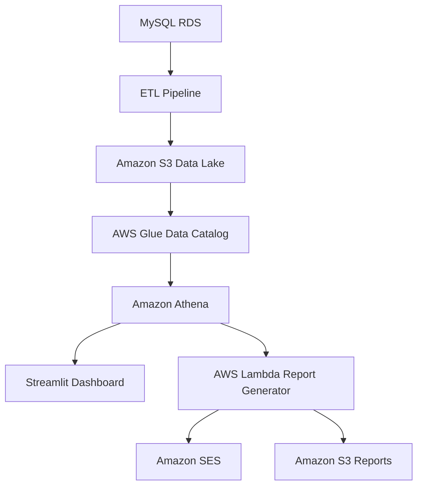

# Catering Fleet Data Migration and Analytics Platform

An end-to-end data engineering project that migrates operational sales data into a scalable AWS data lake, automates periodic data ingestion, and delivers interactive analytics and daily performance reporting for a mobile catering business.

## Project Overview

This project focuses on modernising the data infrastructure of a catering company that operates a fleet of mobile food vendors across multiple locations. Each vehicle operates semi-independently, with its own menu, trading location, and customer base. Sales transactions are recorded in an operational MySQL database hosted on Amazon RDS.

As the business grows, the cost of maintaining the existing relational database has increased. The company therefore requires a more cost-effective, scalable, and flexible architecture for storing and analysing historical and ongoing sales data.

The solution migrates existing transaction data into an AWS data lake and establishes an automated pipeline for ingesting new transactions every three hours. The processed data is stored in Amazon S3 in Parquet format and made available for analysis through AWS Glue and Amazon Athena.

An interactive Streamlit dashboard enables users to explore sales performance, while an automated reporting workflow generates and emails a daily summary of business activity.

The platform is built using Python, AWS, Docker, and Terraform, with an emphasis on modularity, automation, cost efficiency, and maintainability.

## Project Objectives

The main objectives are to:

* Migrate historical transaction data from MySQL RDS to an AWS data lake.
* Reduce the cost of storing and querying analytical data.
* Automate the extraction and processing of new transactions every three hours.
* Validate and transform raw data into a consistent analytical format.
* Store datasets in partitioned Parquet files on Amazon S3.
* Catalogue datasets using AWS Glue and query them through Amazon Athena.
* Develop an interactive dashboard for exploring sales and operational performance.
* Generate and email a daily summary report automatically.
* Provision and manage cloud infrastructure using Terraform.
* Containerise applications with Docker and deploy them through AWS services.
* Implement automated tests to improve reliability and maintainability.
* Keep the ETL pipeline, dashboard, and reporting workflow independent of one another.

## Business Context

The catering business operates multiple mobile food vendors at locations such as town centres, office complexes, event venues, and other areas with high customer footfall.

Each vehicle may serve different products and attract different customers. Analysing transaction data allows the business to understand demand, compare performance, and make better operational decisions.

The platform supports analysis of:

* Revenue and transaction volumes across the fleet.
* Sales performance by vehicle and location, where location data is available.
* Daily, hourly, and monthly sales trends.
* Payment method usage.
* Differences in performance between vehicles.
* Missing or unexpectedly inactive sales data.
* Consistent underperformance over time.
* Opportunities to reduce infrastructure costs and improve business profitability.

The resulting insights support both day-to-day operational decisions and longer-term business planning.

## Architecture

The solution consists of three independent workflows that share a central data lake.



### 1. Data Migration and ETL Pipeline

The ETL pipeline extracts transaction data and reference tables from MySQL RDS, validates and transforms the records, and loads the resulting datasets into Amazon S3.

The pipeline supports both the initial historical migration and ongoing incremental ingestion.

For the initial migration, the pipeline extracts the existing dataset and prepares it for analytical storage. Subsequent executions retrieve newly available transactions without unnecessarily reprocessing the entire historical dataset.

The pipeline runs as an Amazon ECS Fargate task, triggered every three hours by Amazon EventBridge.

Its responsibilities include:

* Connecting to the operational MySQL database.
* Extracting historical and newly available transactions.
* Extracting truck and payment method reference data.
* Validating records and handling data quality issues.
* Transforming data into a consistent analytical schema.
* Writing partitioned Parquet files to Amazon S3.
* Supporting incremental processing and safe retries.
* Making datasets available through AWS Glue and Amazon Athena.
* Logging execution results and errors for monitoring.

Incremental extraction should use a reliable watermark, transaction identifier, or equivalent tracking mechanism. The implementation should also account for late-arriving records and updates where applicable.

Repeated executions should be designed to avoid duplicate analytical records.

### 2. Data Lake and Analytics Layer

Amazon S3 provides the central storage layer for the platform. The data is stored in Parquet format, which supports efficient analytical queries and can reduce storage requirements compared with uncompressed CSV files.

AWS Glue maintains the metadata required to interpret the datasets, while Amazon Athena provides a SQL interface for querying data directly in S3.

The main datasets are:

| Dataset              | Description                                       |
| -------------------- | ------------------------------------------------- |
| `FACT_Transaction`   | Transaction records and associated sales measures |
| `DIM_Truck`          | Truck identifiers and descriptive attributes      |
| `DIM_Payment_Method` | Payment method identifiers and descriptions       |

The data lake separates data storage from query processing, allowing the business to retain historical information without relying on a continuously running relational database for reporting workloads.

Partitioning transaction data by an appropriate date field can further improve query efficiency and control Athena costs.

### 3. Interactive Analytics Dashboard

The dashboard is built with Streamlit and queries analytical data through Amazon Athena.

It provides an interactive interface for exploring:

* Total revenue and transaction volumes.
* Sales performance by vehicle.
* Daily, hourly, and monthly sales trends.
* Comparisons between vehicles.
* Payment method usage.
* Revenue changes over time.
* Location-level performance, where the relevant data is available.

The dashboard runs as a continuously available application on Amazon ECS.

It is deployed independently of the ETL pipeline, allowing users to access the application without depending on the ingestion task being active.

The dashboard reads from the shared data lake rather than maintaining its own copy of the analytical data.

### 4. Automated Daily Reporting

An AWS Lambda function generates a daily HTML report using analytical data queried from Amazon Athena.

The report summarises the previous day's business performance and can include:

* Total revenue and transaction counts.
* Revenue and sales comparisons by vehicle.
* Identification of high- and low-performing vehicles.
* Missing or unexpectedly inactive vehicles.
* Recurring underperformance across reporting periods.
* Comparisons with previous days, where sufficient historical data is available.

Amazon SES distributes the report by email to the designated recipient. Generated HTML reports are also stored in an S3 reports location for future reference.

The reporting workflow runs independently of the dashboard and ETL application, with its own execution schedule and deployment process.

The report should distinguish between a vehicle with no recorded transactions and a vehicle whose data may be missing because of an ingestion or reporting issue.

## Technology Stack

| Technology          | Purpose                                                           |
| ------------------- | ----------------------------------------------------------------- |
| Python              | Data extraction, transformation, reporting, and application logic |
| MySQL               | Operational database                                              |
| Amazon RDS          | Hosted relational database                                        |
| Amazon S3           | Data lake and report storage                                      |
| Apache Parquet      | Efficient analytical data storage                                 |
| AWS Glue            | Data catalog and schema metadata                                  |
| Amazon Athena       | SQL queries against data stored in S3                             |
| Streamlit           | Interactive analytics dashboard                                   |
| Amazon ECS Fargate  | Containerised ETL execution and dashboard hosting                 |
| Amazon EventBridge  | Scheduled workflow triggers                                       |
| AWS Lambda          | Daily report generation                                           |
| Amazon SES          | Email delivery                                                    |
| Amazon ECR          | Container image storage                                           |
| AWS Secrets Manager | Secure storage of database credentials                            |
| AWS IAM             | Identity and access management                                    |
| Docker              | Application containerisation                                      |
| Terraform           | Infrastructure provisioning and management                        |
| pytest              | Automated testing                                                 |

Existing AWS infrastructure should be reused where appropriate to avoid unnecessary duplication and additional costs.

## Repository Structure

The repository is organised into independent components.

```text
catering-fleet-data-platform/
├── pipeline/
│   ├── pipeline.py
│   ├── requirements.txt
│   ├── Dockerfile
│   └── docker-compose.yml
├── dashboard/
│   ├── dashboard.py
│   ├── requirements.txt
│   ├── Dockerfile
│   └── docker-compose.yml
├── report/
│   ├── lambda_function.py
│   ├── local_report_generator.py
│   ├── requirements.txt
│   └── Dockerfile
├── scripts/
│   ├── deploy_report_generator.sh
│   ├── deploy_pipeline.sh
│   ├── run_pipeline.sh
│   ├── start_dashboard.sh
│   └── stop_dashboard.sh
├── terraform/
│   ├── main.tf
│   ├── variables.tf
│   ├── outputs.tf
│   └── terraform.tfvars.example
├── tests/
├── .github/
├── .gitignore
├── .env.example
└── README.md
```

Run deployment scripts from the repository root with `bash scripts/<script-name>.sh`. Each script resolves its component and configuration paths relative to the repository, so it can also be invoked with an absolute script path from another working directory.

Each component has its own dependencies and execution instructions, allowing it to be developed, tested, and deployed independently.

## Prerequisites

Before running the project, ensure that the following tools and resources are available:

* Python 3.10 or later.
* Docker and Docker Compose.
* Terraform CLI.
* AWS CLI.
* An AWS account with appropriately configured credentials.
* Access to the operational MySQL database.
* Appropriate AWS permissions for infrastructure provisioning and deployment.
* Access to Amazon S3, Glue, Athena, ECR, ECS, Lambda, and SES as required by the deployed components.

The source database must contain the required transaction and reference datasets:

* `FACT_Transaction`
* `DIM_Truck`
* `DIM_Payment_Method`

The AWS environment must also provide suitable networking, security groups, subnets, and access permissions for the deployed workloads.

## Configuration

### Local Environment Variables

For local development, create a local environment file using `.env.example` as a template.

Typical variables include:

```dotenv
AWS_REGION=your-aws-region

DB_HOST=your-database-host
DB_PORT=3306
DB_USER=your-database-user
DB_PASSWORD=your-database-password
DB_NAME=your-database-name

S3_BUCKET_NAME=your-data-lake-bucket
GLUE_DB_NAME=your-glue-database
```

Additional configuration may be required for the Athena workgroup, report recipient, SES sender identity, and other component-specific settings.

Never commit credentials, production secrets, or populated environment files to version control.

For deployed workloads, use IAM roles for AWS access and AWS Secrets Manager for database credentials. Local environment variables are required when running outside AWS-managed execution environments unless an alternative secure authentication method is configured.

### Terraform Variables

Infrastructure variables are defined in `terraform/variables.tf`.

Create a local `terraform.tfvars` file based on the example configuration and provide the required values, including:

* Infrastructure name.
* AWS region.
* Database connection details.
* VPC and subnet identifiers.
* ECS cluster ARN.
* Data lake configuration.
* Component deployment options.

Use suitable secret-handling practices for sensitive values and avoid committing populated variable files containing credentials.

## Infrastructure Provisioning

Navigate to the Terraform directory:

```bash
cd terraform
terraform init
terraform plan
terraform apply
```

Review the proposed changes before applying them.

The initial infrastructure deployment should create the resources needed by the platform, including the relevant S3 bucket, Glue catalog, ECR repositories, ECS resources, IAM permissions, and Secrets Manager entries.

Existing infrastructure should be reused wherever possible.

### Deploying the Reporting Lambda

If the Lambda function uses a container image that does not yet exist in ECR, deploy the supporting infrastructure first without enabling Lambda deployment.

After the initial Terraform deployment:

1. Build and push the report container image to ECR.
2. Enable the Lambda deployment option in the Terraform configuration.
3. Run `terraform apply` again to create the function.

From the repository root, run:

```bash
bash scripts/deploy_report_generator.sh
```

Then return to the Terraform directory and apply the updated configuration.

This avoids attempting to create a container-based Lambda function before its image is available.

After a successful deployment, any generated `.env` file should contain only non-sensitive infrastructure configuration. Credentials should remain in AWS Secrets Manager or be supplied through appropriate AWS identity mechanisms.

## Running the Components

### ETL Pipeline

To install dependencies and execute the pipeline locally:

```bash
cd pipeline
pip install -r requirements.txt
python pipeline.py
```

Alternatively, run it in Docker:

```bash
cd pipeline
docker compose up --build
```

To deploy the scheduled pipeline:

```bash
bash scripts/deploy_pipeline.sh
```

To trigger a one-off execution:

```bash
bash scripts/run_pipeline.sh
```

The deployed ECS task should retrieve credentials securely, extract the latest transactions, transform the data, and upload the results to S3.

### Dashboard

To install dependencies and run the dashboard locally:

```bash
cd dashboard
pip install -r requirements.txt
streamlit run dashboard.py
```

The application is typically available at:

`http://localhost:8501`

Alternatively, use Docker Compose:

```bash
cd dashboard
docker compose up --build
```

To deploy or scale up the dashboard service:

```bash
bash scripts/start_dashboard.sh
```

To scale down the dashboard service when it is not required:

```bash
bash scripts/stop_dashboard.sh
```

The dashboard requires permission to query Athena and access the relevant Glue database and tables.

### Daily Report

To generate a report locally:

```bash
cd report
pip install -r requirements.txt
python local_report_generator.py
```

The local generator should create an HTML file named according to the reporting date, for example:

```text
daily_report_YYYY_MM_DD.html
```

To build and push the report generator Lambda container image to ECR:

```bash
bash scripts/deploy_report_generator.sh
```

Once the image is available in ECR and the supporting infrastructure has been provisioned, deploy the Lambda function through Terraform.

The deployed reporting workflow should run automatically each morning, query the previous day's data, generate the report, save the HTML output to S3, and send the email through SES.

## Workflow Scheduling

Each workflow has its own execution model.

| Workflow     | Schedule               | Purpose                                                        |
| ------------ | ---------------------- | -------------------------------------------------------------- |
| ETL pipeline | Every three hours      | Extract new transactions and update the data lake              |
| Dashboard    | Continuously available | Provide interactive access to analytical data                  |
| Daily report | Once each morning      | Summarise the previous day's performance and email the results |

Amazon EventBridge should trigger the scheduled workloads at appropriate times.

The daily reporting schedule should account for the business's local time zone and allow sufficient time for the latest ETL execution to finish before the report is generated.

The dashboard should not depend on the ETL task remaining active, and the report generator should query the shared data lake rather than rely on state maintained by the dashboard.

## Data Quality and Reliability

The pipeline should handle missing data, retries, late-arriving transactions, and intermittent failures.

Recommended practices include:

* Use incremental extraction based on a stable transaction identifier or update watermark.
* Make repeated ETL runs idempotent wherever possible.
* Validate schemas, timestamps, identifiers, and required fields.
* Track processed, rejected, and failed records.
* Handle periods with no transactions without automatically treating them as pipeline failures.
* Partition transaction data by an appropriate date field.
* Use structured logging and monitor task failures.
* Configure retries and alerts for failed scheduled executions.
* Apply least-privilege IAM policies.
* Keep credentials outside source control.
* Monitor data freshness to identify unexpected ingestion delays.

Data quality checks should ensure that the dashboard and daily report are based on reliable, consistent datasets.

## Testing

Automated tests should cover the main logic in each component.

Install the dependencies and test framework:

```bash
pip install -r pipeline/requirements.txt
pip install -r dashboard/requirements.txt
pip install -r report/requirements.txt
pip install pytest
```

Run the test suite from the repository root:

```bash
pytest tests/
```

Where dependencies conflict, use separate virtual environments for individual components.

### Pipeline Tests

Recommended test coverage includes:

* Data extraction and incremental filtering.
* Transformation and schema validation.
* Missing and invalid values.
* Parquet output generation.
* S3 upload behaviour.
* Retry safety and duplicate prevention.

### Dashboard Tests

Recommended test coverage includes:

* Query construction.
* Data aggregation.
* Empty datasets and missing values.
* Date-range filtering.
* Handling unexpected query results.

### Reporting Tests

Recommended test coverage includes:

* Previous-day date calculations.
* Revenue and transaction summaries.
* Missing-vehicle detection.
* HTML report generation.
* Email payload construction.

Integration tests should verify the connections between the ETL pipeline, S3, Glue, Athena, dashboard, and reporting workflow.

## Deployment Strategy

A recommended deployment sequence is:

1. Configure AWS credentials, network access, and project variables.
2. Provision shared infrastructure using Terraform.
3. Build and push the ETL and dashboard container images to ECR.
4. Deploy and test the ETL task.
5. Verify the generated S3 files and query the datasets through Athena.
6. Deploy the Streamlit dashboard.
7. Build and push the reporting container image.
8. Enable and deploy the Lambda function.
9. Configure schedules, email permissions, and report recipients.
10. Run end-to-end tests and review operational logs.

Infrastructure changes should be managed through Terraform wherever possible. Application deployments should not require unnecessary changes to unrelated resources.

## Security and Cost Management

The platform is designed to reduce reliance on a continuously running relational database for analytical workloads.

Cost and security considerations include:

* Store analytical data in S3 using an efficient columnar format.
* Partition datasets to reduce unnecessary Athena scans.
* Monitor query usage and storage costs.
* Use S3 lifecycle policies where appropriate.
* Scale down dashboard infrastructure when continuous availability is not required.
* Use IAM roles instead of long-lived AWS access keys in deployed workloads.
* Store database credentials in AWS Secrets Manager.
* Restrict network access to the operational database.
* Apply least-privilege access policies.
* Avoid logging credentials or sensitive connection details.
* Monitor scheduled executions and configure failure notifications.

The actual cost savings depend on transaction volume, query patterns, storage retention, and the amount of compute required by the dashboard and scheduled workloads.

## Expected Outcomes

The completed platform provides:

* A scalable data lake for historical and ongoing transaction data.
* Automated ingestion of new sales records.
* Queryable analytical datasets using Glue and Athena.
* An interactive dashboard for monitoring business performance.
* Automated daily HTML reports delivered through email.
* Independent deployment and execution of the ETL, dashboard, and reporting components.
* Reproducible infrastructure managed through Terraform.
* Containerised applications and automated testing.
* A foundation for additional datasets, reporting requirements, and analytical use cases.

## Future Improvements

Potential extensions include:

* CloudWatch dashboards, alarms, and operational metrics.
* Automated alerts for failed jobs and stale data.
* Improved historical backfills and schema evolution handling.
* Additional dashboard filters and product-level analytics.
* Cost monitoring for Athena queries and S3 storage.
* Continuous integration and deployment workflows.
* Data retention and lifecycle management policies.
* Sales forecasting and demand analysis.
* More advanced location and vehicle performance comparisons.

## Summary

The Catering Fleet Data Migration and Analytics Platform modernises the company's reporting infrastructure by moving operational sales data into a scalable AWS data lake.

Python handles extraction and transformation, Amazon S3 stores analytical data, AWS Glue and Athena enable SQL-based analysis, Streamlit provides an interactive dashboard, and AWS Lambda with SES automates daily reporting.

Docker and Terraform support consistent application deployment and infrastructure management, while independent workflows and automated tests improve maintainability and reliability.

The result is a flexible data engineering platform that supports business analysis, operational decision-making, and more cost-effective management of analytical data.
