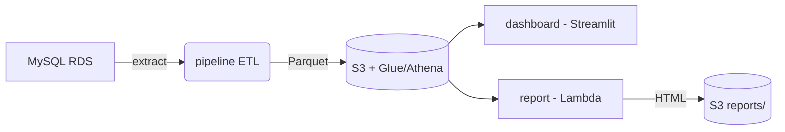

# Food Truck Analytics Platform

An end-to-end data platform for a food truck fleet. It ingests transaction data from an operational MySQL database, lands it in S3/Athena as an analytics data lake, and exposes it through a live dashboard and an automated daily report — all provisioned as AWS infrastructure with Terraform.

## Purpose

The fleet's point-of-sale system writes every transaction to a MySQL (RDS) database. This project turns that operational data into something the business can act on:

- **`pipeline/`** — An ETL job that incrementally extracts new transactions (plus truck and payment method reference data) from MySQL, validates/transforms them, and loads them into S3 as partitioned Parquet, queryable via AWS Glue/Athena.
- **`dashboard/`** — A Streamlit app that queries Athena to visualize revenue and sales trends per truck, by day/hour/month.
- **`report/`** — A daily HTML report (run as a Lambda) that summarizes the previous day's performance, flags over/under-performing or missing trucks, and highlights recurring bottom performers.
- **`terraform/`** — Infrastructure-as-code that provisions the ECS services/tasks, Lambda, ECR repositories, Glue catalog, S3 bucket, and secrets used by the three components above.



## Repository Structure

| Folder | What it does | More detail |
| --- | --- | --- |
| `pipeline/` | Extract-Transform-Load job (MySQL → S3 Parquet) | [pipeline/README.md](pipeline/README.md) |
| `dashboard/` | Streamlit dashboard over Athena data | [dashboard/README.md](dashboard/README.md) |
| `report/` | Daily HTML fleet report generator (Lambda) | [report/README.md](report/README.md) |
| `terraform/` | AWS infrastructure for all of the above | see below |
| `tests/` | Unit tests for pipeline, dashboard, and report code | see below |

## Prerequisites

- Python 3.10+
- Docker (for containerized runs/deploys)
- An AWS account with credentials configured locally (`aws configure` / SSO / env vars)
- Terraform CLI (for provisioning infrastructure)
- Access to a MySQL database with the food truck schema (`DIM_Truck`, `DIM_Payment_Method`, `FACT_Transaction`)

## Setting Up the Infrastructure

The AWS infrastructure (ECS cluster resources, Lambda, ECR repos, S3 bucket, Glue database/tables, Secrets Manager entries) is provisioned with Terraform:

```bash
cd terraform
terraform init
terraform apply
```

Required variables are defined in `terraform/variables.tf`; provide real values via `terraform/terraform.tfvars` (or `-var`/environment variables) — see that file for the variables you need to set (infrastructure name, AWS region, DB connection details, VPC/subnet IDs, ECS cluster ARN).

`deploy_report_generator_lambda` has no default, so if it isn't set in `terraform.tfvars`, `terraform apply` will interactively prompt:

```text
var.deploy_report_generator_lambda
  Deploy the report generator Lambda function?
  Only set to 'yes' AFTER you have pushed the Docker image to ECR using: bash report/build_and_push.sh

  Enter a value:
```

The first time you apply, answer `no` — the report Lambda's image doesn't exist in ECR yet, so deploying it would fail. This still provisions everything else (ECR repos, ECS services, S3, Glue, etc.). Once that first apply finishes:

1. Run `report/build_and_push.sh` to build and push the report image to ECR.
2. Run `terraform apply` again and answer `yes` this time (or set `deploy_report_generator_lambda = "yes"` in `terraform.tfvars` to skip the prompt) to create the Lambda function.

After a successful `apply`, Terraform writes a `.env` file to the repository root (from `env_template`) containing the non-sensitive infrastructure values (ECR URIs, ECS ARNs, etc.) that the pipeline and dashboard deploy scripts read. Sensitive credentials are stored in AWS Secrets Manager rather than this file.

## Running Each Component

In normal usage these components are deployed to AWS (ECS Fargate / Lambda), not run on your machine directly. See the linked README for full details; the short version:

### Pipeline (ETL)

```bash
cd pipeline
./deploy_pipeline.sh         # build/push image; runs on an EventBridge schedule
./run_pipeline.sh            # trigger a one-off run on ECS Fargate
```

### Dashboard

```bash
cd dashboard
./start_dashboard.sh         # deploy/scale up on ECS
./stop_dashboard.sh          # scale down on ECS
```

### Daily Report

```bash
cd report
./build_and_push.sh          # build/push the Lambda container image
```

For this deployed usage, the root `.env` file (generated by `terraform apply` from `env_template`) only contains non-sensitive infrastructure values (ECR URIs, ECS ARNs, etc.) — it does **not** contain DB or AWS credentials. The deployed ECS tasks/Lambda get DB credentials from AWS Secrets Manager and AWS access from their IAM roles, so no manual secrets are needed.

## Running Locally / Testing

To run a component directly on your machine — whether via `python`/`streamlit` or via `docker-compose` (both `pipeline/docker-compose.yml` and `dashboard/docker-compose.yml` also read the root `.env` via `env_file: ../.env`) — you're not using the ECS task role or Secrets Manager, so you must add DB/AWS credentials yourself (e.g. `DB_HOST`, `DB_USER`, `DB_PASSWORD`, `DB_NAME`, `AWS_ACCESS_KEY_ID`, `AWS_SECRET_ACCESS_KEY`, `GLUE_DB_NAME`, `S3_BUCKET_NAME`) to that `.env` file.

```bash
cd pipeline && pip install -r requirements.txt && python pipeline.py             # run the ETL locally
cd pipeline && docker-compose up                                                # or run the ETL in local Docker

cd dashboard && pip install -r requirements.txt && streamlit run dashboard.py    # run the dashboard locally at http://localhost:8501
cd dashboard && docker compose up --build                                       # or run the dashboard in local Docker

cd report && pip install -r requirements.txt && python local_report_generator.py # writes daily_report_YYYY_MM_DD.html locally
```

Unit tests for the pipeline, dashboard, and report modules live in `tests/`, with paths wired up in `tests/conftest.py`:

```bash
pip install -r requirements.txt pytest
pytest tests/
```
